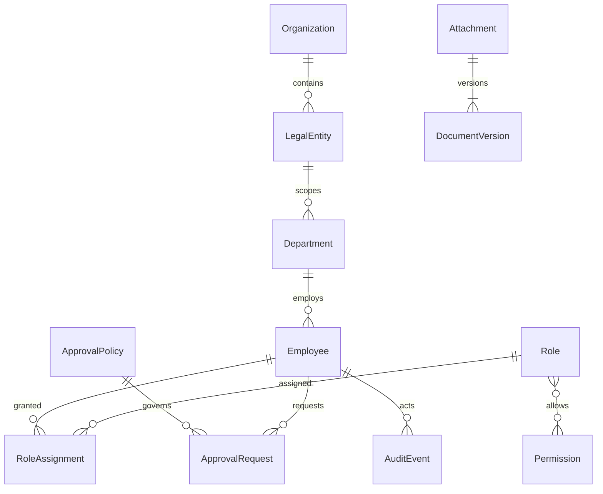
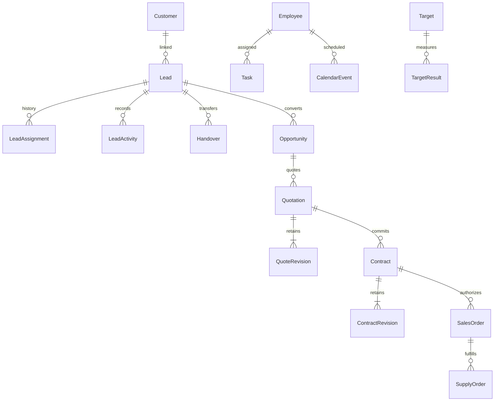
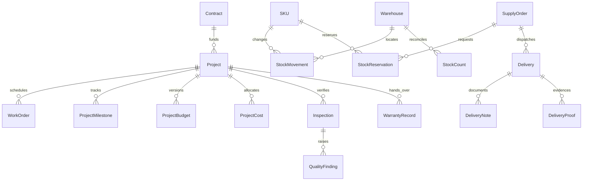
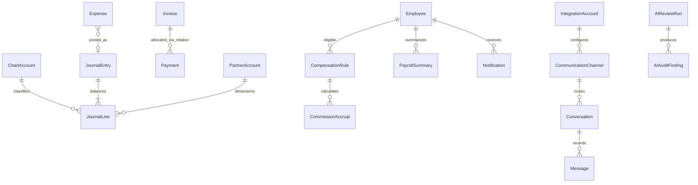

# Logical ERD — Proposed وليس schema نهائياً
الرسوم تحدد روابط business لا إلزام شكل الجداول أو PK type. كل aggregate يحتفظ entity_id وstable ID وversion وUTC created_at/updated_at وactor عند الانتقال. IDs provider ليست PK. FK تشمل scope عند الحاجة لمنع ربط entities مختلفة. الحقول التفصيلية وindexes تعتمد مع migrations بعد ADR.

PaymentAllocation associative relation مقترحة لتعدد دفعات/فواتير؛ الرسم المبسط لا يفرض one-payment-one-invoice. DocumentLink وAudit subject وAI finding subject مراجع typed مع authorization لا foreign key polymorphic غير محكوم. OutboxEvent/ConsumerReceipt infrastructure aggregates مع uniqueness `(consumer,event_id)`.

Ownership مطابق [catalog](MODULE_CATALOG.md): ledger immutable في Finance، stock movements في Inventory، contract revisions في Sales. Monetary value = decimal amount + currency + approved rounding؛ لا float ولا جمع currencies بلا conversion policy. quantities بوحدة وتحويل versioned حسب OPEN-04. UTC timestamps مع timezone للعرض/مواعيد التقويم؛ posting_date وفترة مالية business dates مستقلة.

soft-delete/archive للmaster data المسموح مع uniqueness/history وإبقاء FK؛ لا delete customer عند offboarding، لا تعديل journal/stock posted أو approved revision. corrections عبر reversal/revision وsource reference. immutable audit وapproval history لا تحمل raw secrets. entity_id ليس multi-tenant signup؛ حسابات/مخزون/مشروعات scoped منذ التصميم. تاريخ الاحتفاظ/erase legal OPEN-10 وقد يتطلب anonymization دون كسر financial archive.