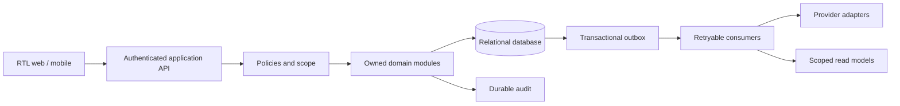

# تصميم الحل

## Implemented architecture snapshot — 2026-10-18

The application is one Laravel modular monolith with central HTTP controllers and
Blade views. Modules organize Domain/Application/Infrastructure/Presentation code,
but several module folders are scaffolds. Domain Records and guards hold business
rules; runtime Application services use Laravel Query Builder and transactions.
There is no general Eloquent model or repository layer to preserve or introduce.

Examples: CRM `LeadDirectory` delegates authorization to Identity `AccessControl`,
uses CRM domain transitions and calls Tasks `TaskCycle` for follow-ups. Employee and
Organization directory services also access `access_*` tables. Some persistence
remains in `AccessController`. These are actual cross-module/table seams requiring
owner-aware review, not proof of universally enforced boundaries. Infrastructure
diagnostic adapters and Platform policy-intent checks do not globally intercept writes.

The CRM actor wrapper uses a transaction/company lock even for some reads; contention
is an unmeasured risk. Domain `OutboxRecoveryContract` depends on the concrete in-memory
store. Current outbox evidence comprises intent metadata, a synthetic in-memory store,
tests and a standalone SQL schema under `database/migrations/outbox/`; this is not a
wired durable Laravel outbox publisher/inbox worker or proof of production delivery.

Frontend uses `layouts.shell`, components under `resources/views/components/{ui,erp,ai}`
and semantic CSS tokens. CSS/plain JavaScript are embedded by the shared shell; no
Vite/SPA migration is needed. See the [component catalog](../design-system/README.md).

### Demo data boundary

The inspected original/main local working tree includes untracked `app/Demo` generators and console
commands. Custom deterministic scenario generation is compatible with Query Builder
and Domain Records; Laravel Seeders may be a thin invocation adapter if later needed.
Eloquent Factories would require a new model layer and are not justified here.
Prefer existing application services when a scenario must exercise business rules;
direct bulk fixture inserts must remain explicitly synthetic and scoped.

Do not treat the untracked commands as accepted production-safe tooling: seed has an
environment guard and transaction, but the inspected clean command directly calls
purge without equivalent environment/transaction protection. Scope/name checks reduce
the deletion scope but do not make production execution safe. This mission audits
that work without changing or executing it; its owner must resolve the cleanup risk.

The remaining sections describe target contracts/proposals and decision requirements.
They must not be read as evidence that all layers, queues, policies or modules exist.
## حالة المعرفة
Confirmed: Laravel من المستخدم؛ ضوابط PRD، relational transactions، private storage، secured API، outbox، Arabic RTL، deployment داخلي. Proposed: modular monolith واحد مع workers منفصلة تشغيلياً، domain/application/infrastructure لكل module. OPEN: version/packages وdatabase/queue/cache/search/storage/hosting/mobile/providers؛ راجع [ADR](ADR-INDEX.md) و[القرارات](../governance/OPEN_DECISIONS.md).

## العقود والحدود
Application service يحقق authz ثم expected version ثم invariants داخل transaction. الـ module يملك كتابة aggregate بالكامل. لا يكتب consumer في جدول module آخر؛ يستدعي عقده أو يبني projection يملكه. Shared kernel صغير: IDs/Clock/Money/Correlation، لا business models. اعتمادات domain على interfaces لا Laravel facade أو provider SDK. Circular imports ممنوعة.

Sync للاستعلامات والأوامر التي تحتاج نتيجة حتمية، بعقود typed وscope صريح. event بعد commit للآثار المتأخرة؛ لا يُستخدم eventual consistency لتجاوز stock limit أو balanced journal. outbox row والتغيير وaudit intent في نفس transaction، publisher يعيد المحاولة وconsumer يسجل inbox dedup مع أثره في transaction واحدة. at-least-once وليس exactly-once عبر الشبكة.

## البنية التشغيلية
Proposed: database relational مع row locking/unique constraints؛ الاختيار PostgreSQL مقابل MySQL/MariaDB ينتظر ADR. البداية database-backed queue/search ممكنة لتقليل التشغيل مقابل محركات متخصصة؛ cache ليس authority ولا يشارك نتائج مستخدم مع آخر. search index يحتوي حقولاً مسموحة فقط ويعيد authorization قبل العرض. storage خاص مع quarantine وscan وchecksum وsigned short-lived access بعد policy؛ provider OPEN. index/cache قابلان لإعادة البناء.

mobile/PWA أو native/hybrid ضمن OPEN-08؛ لا offline posting معتمد. API مشترك وretry آمن وupload resumability مقترح. RTL منذ shell؛ translation keys وbidi isolation وتواريخ محلية مع UTC وتنسيق عملات دون float. UI framework وpackages Proposed.

## الأمن والمراقبة
جلسات/tokens قابلة للإلغاء، deny by default، entity scope وfield masks حتى exports/search/notifications. تطبيق SoD داخل domain لا UI. secrets خارج repository، encryption transport/at-rest، provider least privilege. correlation من API إلى outbox وprovider؛ logs دون contacts أو raw AI prompts. مؤشرات backlog age/retries/DLQ/duplicate suppression/approval rejection؛ numeric SLOs OPEN-11. AI read models minimized ولا privileged tools؛ فشله لا يلغي deterministic gates.

## امتداد مقترح: AIActionAssistant وProactiveOperationalIntelligence

التفاصيل المقيدة وحالة التنفيذ في [معمارية المساعد](AI_ASSISTANT_ARCHITECTURE.md) و[تغطية كل ميزة بأداة/استثناء واختبار](../engineering/AI_TOOL_COVERAGE.md). التصميم مستقبلي غير معتمد: orchestrator واحد وprovider-agnostic Gateway اختياري، registry typed صريح وcentral allowlist، وdeterministic executor يستدعي نفس module-owned ApplicationService مثل UI/API. لا auto-discovery/reflection أو generic execute أو business logic في assistant. Module owner يملك tools/tests؛ القائمة المركزية تضبط الإتاحة فقط.

كل ميزة أعمال مستقبلية تدخل سجل coverage في task تنفيذها نفسه، مع permission/scope/filtering قبل الاستعلام بما يشمل counts/pages/aggregates/export، contract versioning/preconditions/confirmation/approval/idempotency/tests وdetector assessment أو `N/A` مسوغ. لا تكفي schema وحدها. الأداة غير الجاهزة تبقى `Restricted/disabled`، ويمنع تفعيلها أو صلاحية أعلى من UI/API. ADR-007 advisory output بلا tools؛ action channel منفصل يحتاج scope/ADR approval، ولا تخلط هذه التوصية مع قرار معتمد. المقترح proactive يستعمل Scheduler + DomainEvents/outbox + DB queues وقواعد حتمية أولاً؛ لا Redis/vector DB/microservices/multi-agent. سجلات التطبيق الحالية لا تتضمن ERP tools أو provider enabled؛ تبقى الحقائق الحالية منفصلة عن المقترح.
