# كتالوج workflows — states Proposed ما عدا ضوابط PRD
كل transition يمر authorization + scope + expected version + deterministic guards + transaction + immutable history/audit + outbox. رفض الانتقال لا يغير aggregate ويولد security evidence عند الحساسية. لا status PATCH مباشر. identifiers أدناه أسماء تصميمية لا schema نهائي. OPEN-02 يحجب تشغيل chains الفعلية.

## approvals
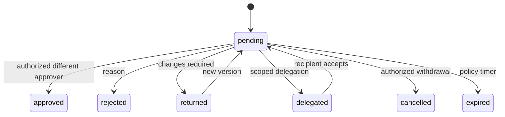
approved مربوط subject version/hash؛ revision يلغي صلاحيته للنسخة الجديدة. delegated/returned يحتفظان history ولا يتحولان approve ضمنياً. expired escalation لا يعتمد تلقائياً. self-approval/break-glass وفق OPEN-02.

## lead handover
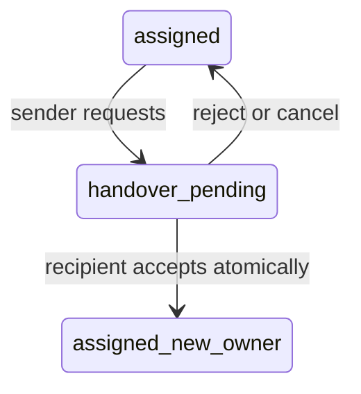
المالك القديم مسؤول حتى commit القبول، لا pending duplicate متنافس. attachments scoped وtask تذكير وصلاحيات new owner بعد القبول. AT-02.

## quote → contract → order
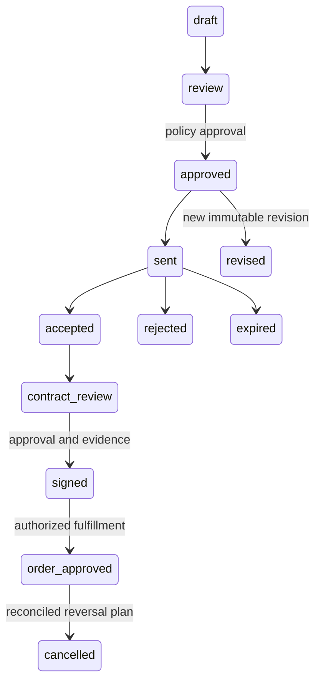
quote cancelled متاح بpolicy قبل الالتزام؛ بعد الالتزام cancellation يتطلب downstream reconciliation. العقد من authorized source كذلك ممكن؛ لا يشترط quote لكل الحالات. signature وحدها لا revenue ولا physical issue؛ OPEN-03/05/01 تضبط downstream effects. AT-03.

## stock reserve/issue
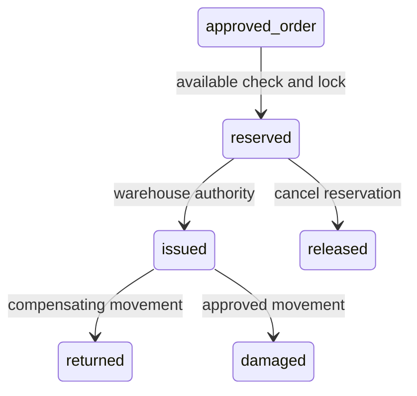
on_hand لا ينقص عند reserve، available=on_hand-active_reservations. issue يستهلك reservation ويخصم physical مرة؛ units/negative/valuation OPEN-04. count variance review ثم adjustment approval، receipts provenance لا procurement. AT-04.

## delivery / POD
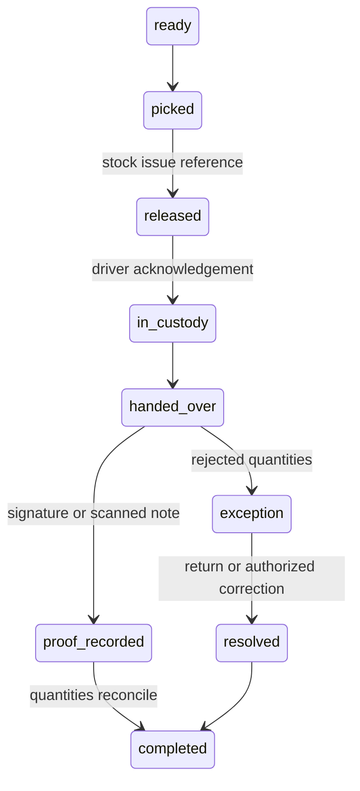
POD recipient/time/accepted/rejected/reason وإثبات خاص؛ no complete لمجرد upload بدأ. فقد اتصال retry idempotent، no offline stock commit. AT-05.

## project closure
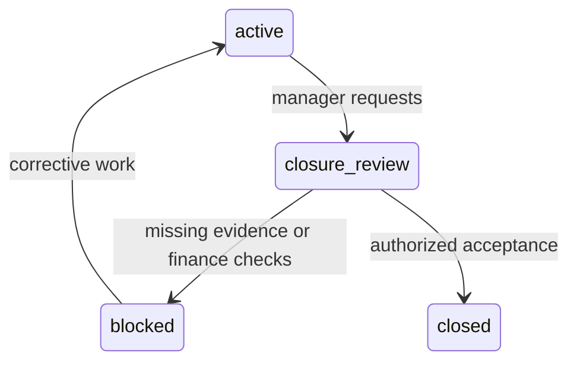
checks: delivery/POD، QA، acceptance checklist، materials used/unused/returned/damaged، source costs، financial requirements، warranty handoff؛ OPEN-12 وOPEN-05 تضبط التفاصيل. reopened change يتطلب authority/history لا overwrite. AT-06.

## finance posting / reversal / period close
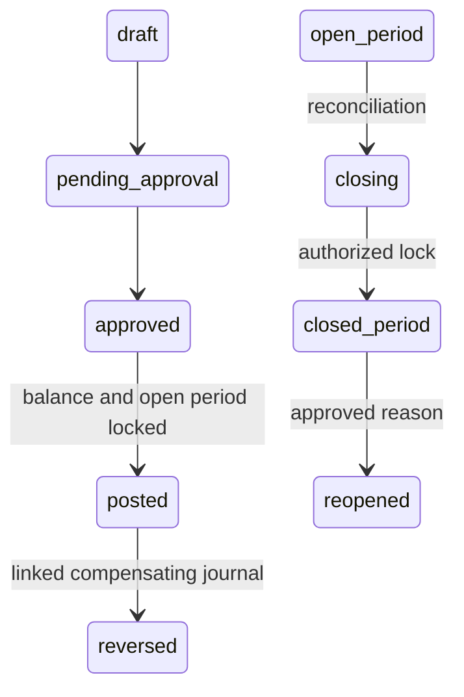
post atomic، debits=credits، unique source، valid dimensions؛ expense approved لا paid تلقائياً. reversal بتاريخ مسموح لا تعديل original؛ close/post race lock موحد. partner drawing ليس expense، intake ليس operating expense افتراضياً. OPEN-03/04/05. AT-07/15.

## commission reversal
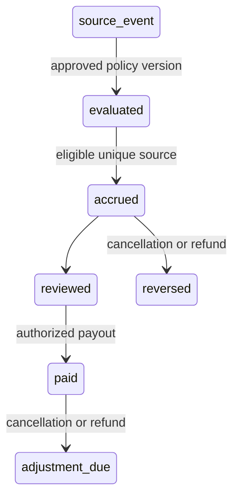
OPEN-01 يحدد trigger/splits/tiers/refunds؛ لا اختيار contract أو collection ضمناً. deduction تحتاج documented managerial approval، missed target لا عقوبة تلقائية. AT-08.

## offboarding
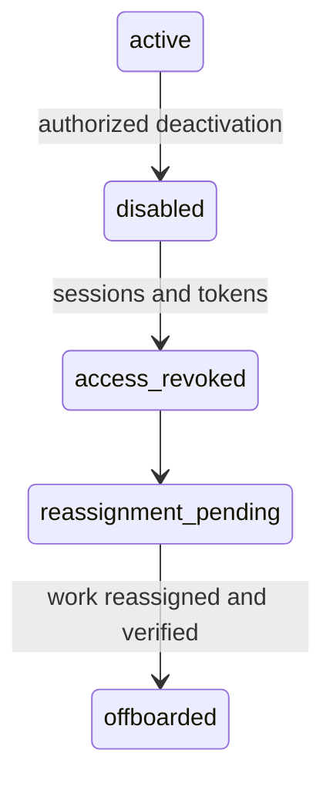
disable يمنع استخدام أي token فوراً حتى background revocation؛ لا delete records، conversations/company channels محفوظة. failure يصعد task ولا يعيد access. AT-12.

## messaging failure
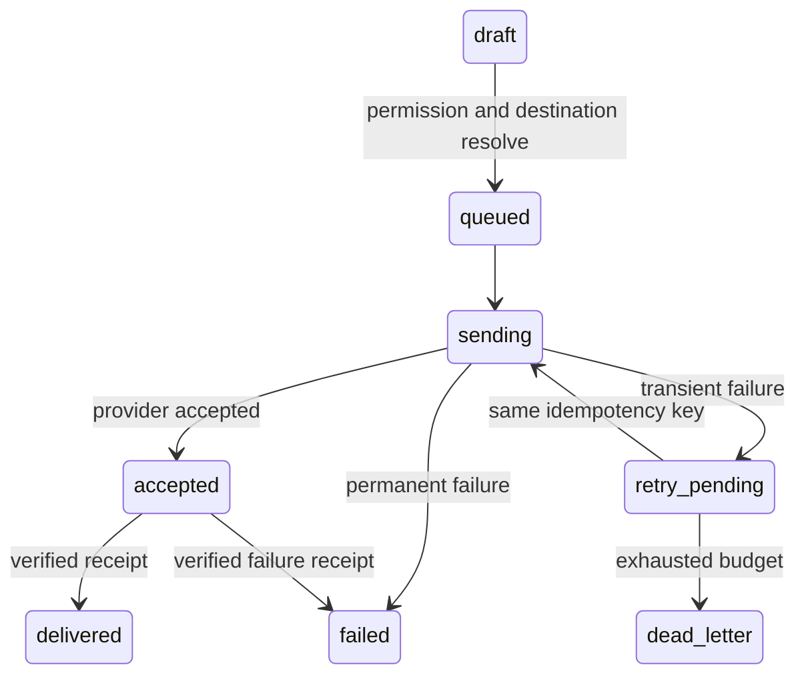
unknown timeout يتطلب provider lookup إن متاح قبل resend؛ لا exactly-once خارجي مفترض. DLQ visible للoperator، headers masked، delivery receipts dedup/out-of-order guarded. OPEN-07. AT-11.

## AI review
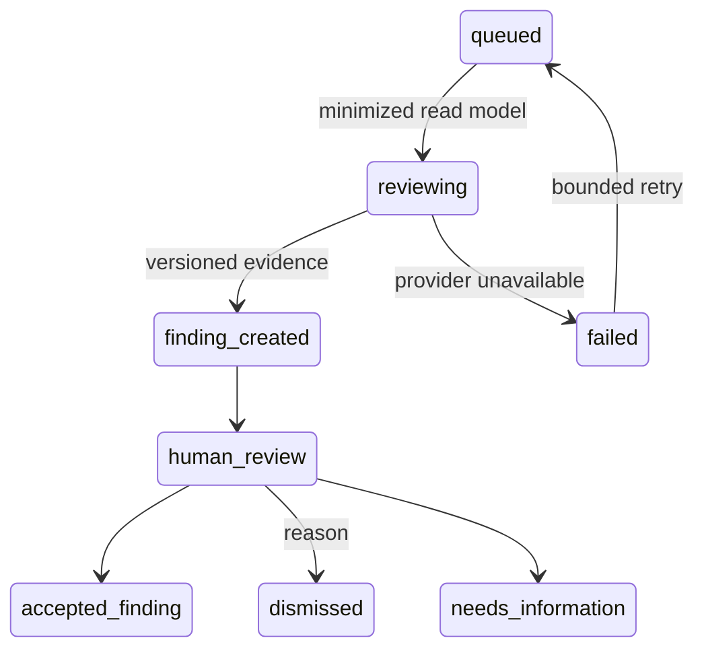
قبول finding لا ينفذ transaction؛ أي action أمر منفصل بصلاحيات وموافقات حتمية. stale subject version يستدعي re-review. synchronous advisory عند latency مناسب فقط ولا bypass عند outage. OPEN-09 وAT-10.